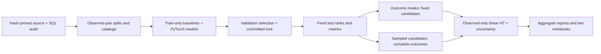

# ExposureRank

**Reliable recommendation evaluation under incomplete user feedback.** A local research implementation for deciding whether an offline model comparison survives changes in outcome observation and candidate selection.

Start with [technical report](reports/technical_report.md), [decision memo](reports/decision_memo.md), [deliverables](DELIVERABLES.md), and [implementation status](IMPLEMENTATION_STATUS.md). Completion requires the executed gate/test/reproduction records, not just files.

## Question and motivation

Can missing feedback or sampled candidate sets change which fixed recommendation model appears better? Train strong baselines, logistic matrix factorization and a small neural interaction challenger, then hold their scores fixed while separately perturbing outcome visibility or candidate universes. This is a static historical observed-cell study, not a production recommender or online engagement test.

## Data and methods

KuaiRec/Gao et al., CIKM2022, [source](https://kuairec.com/), [exact record](https://zenodo.org/records/18164998), DOI10.5281/zenodo.18164998. 2020 interactions,2026 package. Hash-pinned complete small matrix:4,676,570 unique observed pairs,1,411 users,3,327 videos.17,827 absent cells are excluded, never dislikes. Published watch_ratio>=1 is a completion/repeated-play proxy; min(ratio,2)/2 is the bounded secondary reward.

Deterministic pair SHA60/20/20:2,806,319 train,934,854 validation,935,397 test. Warm support is training-only; common observed test catalogs contain595–743 candidates/user. Training-only global/item/bias challengers versus CPU PyTorch MF and a compact nonlinear interaction model. Twelve configurations plus four selected-seed runs; three-seed probability averages, validation-only selection and committed pretest evaluation lock.

Primary macro nDCG@10; Recall10/20, linear DCG/reward, catalog coverage/concentration. Two paired-user contrasts,5000 draws,97.5% percentile intervals: empirical user-composition sensitivity with fixed items, not representative-platform sampling or an exact coverage guarantee.

Nine primary mask conditions plus four floor sensitivities,200 masks each; six separate candidate tasks,200 draws each. HT receives only observed labels/probabilities and corrects linear rewards. Unknown normalized denominators are not fixed by a linear weighting guarantee. Shared draws preserve model pairing; MC uncertainty, users and training seeds remain separate. Optional OPE is skipped.

## Architecture



## Results

| Model | Test macro nDCG@10 |
|---|---:|
| global | 0.303403 |
| item | 0.866461 |
| bias | 0.865832 |
| mf | 0.867470 |
| neural | 0.865921 |

MF minus item: 0.001009; paired97.5% interval [-0.001274, 0.003339]. The neural-minus-MF interval also includes zero. This is inconclusive evidence, not equivalence or online uplift.

All13 mask conditions and6 candidate conditions executed200 shared draws each:3,800 nonfull draws. MF/item ordering reversals under the nine primary naive-mask conditions ranged11%–54%; the full-reference gap is only just above the registered.001 near-tie cutoff. Candidate rates are separate changed-task results. HT corrects matching linear rewards, not arbitrary normalized nDCG.

See reports/tables/full_reference.csv, primary_contrasts.csv, the technical report, and [table/uncertainty dictionary](docs/table_dictionary.md). Every headline in the report is linked to actual tables by evidence/claim_ledger.json and audited by scripts/audit.py. Six scientific figures, two executed notebooks and40 interview questions are included.

Measured original runs:16 learned fits totaled146.92 training seconds, with peak process RSS0.898GiB. Masks took351.93s and candidates486.20s; setup, source validation and clean rebuilding are separate. Direct cloud/API expense$0, excluding existing hardware/electricity/time. The original rebuild record is retained in evidence/reproduction_v1.0.json. The blueprint-audit rebuild passed48 output comparisons in about18.4minutes, including19 private per-user/per-repetition contrast tensors. All16 freshly trained checkpoint state dictionaries also match exactly. The final suite has43 passing tests,0 failures/errors/skips.

## Reproduction

Requires Git, uv and Python3.12 on a CPU environment; locked macOS-arm64 execution is the verified platform. No paid service needed. Raw inputs and trained assets are intentionally absent from the release. Download the exact official archive or pass an existing copy.

```bash
uv sync --frozen --python 3.12
uv run --frozen python scripts/run_all.py --archive /path/to/official/KuaiRec.zip
uv run --frozen python scripts/notebooks.py
uv run --frozen python scripts/audit.py
uv run --frozen pytest
```

To acquire from the official distribution, omit --archive. The expected archive SHA256 is c23f211cf109c7a060a25a4afe9e8c681b1ccbbc816cca921d87ad37dd11c70c. Every archive member is streamed for CRC/SHA. The large matrix is audited only, never trained on. `run_all.py` refuses refitting an already evaluated run; use a new checkout/environment for reproduction.

Stages can be run individually: prepare → pytest → train → freeze → commit lock → evaluate → simulate → report → notebooks → audit. CPU settings, loss/grid/seed rules, target/sampling definitions and tolerances are in configs and docs/analysis_plan.md. Keep checkpoints, maps, outcomes and score arrays private. Training resources and exact final clean-run comparisons are recorded in evidence. No MLflow/MPS/cloud technology is claimed.

## Limitations and release

Selected users/items, unknown original exposure mechanism, absent/blocked cells, missing clocks, heavy ratio tails, static warm holdout, finite seeds, empirical bootstrap and simulation-specific positivity all limit interpretation. Candidate tasks have different denominators;200 repetitions give imperfect MC precision. Negative/inconclusive findings are retained.

License conflict: metadata CC BY4 versus embedded/repository CC BY-SA4 is unresolved. See DATA_NOTICE.md. Original code MIT; conservatively attributed dataset-derived aggregates/reports/figures CC BY-SA4. No raw logs, real maps/per-user metrics, scores, embeddings or checkpoints are redistributed. Public publishing requires a separate decision; no public URLs are claimed. The first four projects and master resume are unchanged.

Blueprint review: [conformance audit](docs/blueprint_conformance_audit.md), [executed checks](evidence/blueprint_conformance.json), and updated local archive dist/ExposureRank_blueprint_verified.zip. The mandatory research core is complete; the aggregate interactive viewer remains the separate presentation step. Optional E10 OPE is skipped.
